# Wazuh SOC Lab: Detection, Enrichment and Automated Response

A defensive security lab built with Wazuh (open source SIEM/XDR). It collects endpoint

telemetry, detects suspicious activity, enriches alerts with threat intelligence, notifies

the analyst in real time and contains threats automatically on Windows and Linux.

Full technical report: [docs/report.pdf](docs/report.pdf)

## Architecture

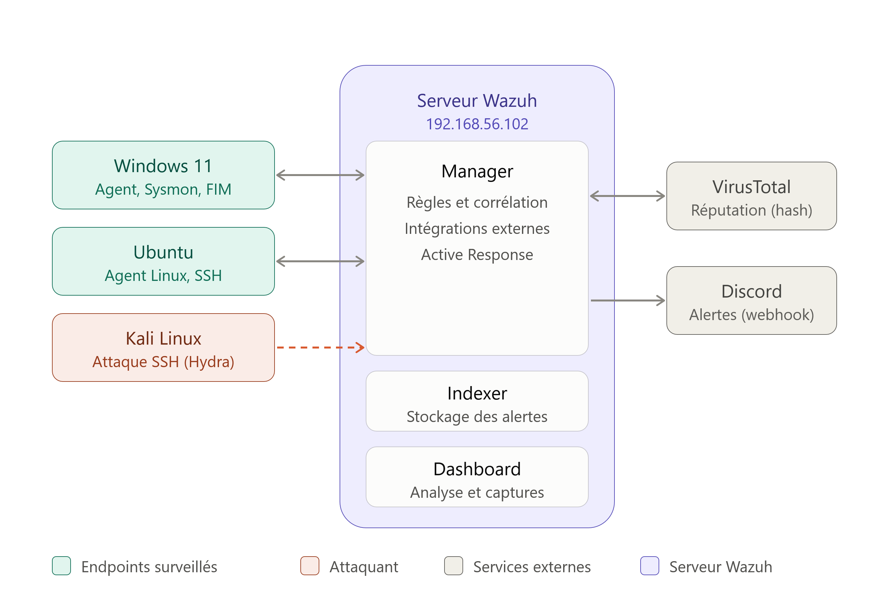

| System | Role |

|---|---|

| Wazuh server (Ubuntu) | Manager, Indexer, Dashboard, Filebeat |

| Windows 11 endpoint | Wazuh agent, Sysmon, File Integrity Monitoring, quarantine response |

| Ubuntu endpoint | Wazuh agent, SSH and sudo logs |

| Kali Linux | Controlled attacker (Hydra), no agent |

| VirusTotal | File reputation (external API) |

| Discord | Analyst notification channel |

Workflow: Monitor -> Detect -> Enrich -> Notify -> Respond -> Contain

## What is implemented

- Sysmon telemetry collected by the Wazuh agent

- Real-time File Integrity Monitoring on a test folder

- VirusTotal enrichment of FIM alerts (rule 87105)

- Custom Discord integration in Python (structured embeds, severity >= 8)

- Active Response on Linux: `firewall-drop` after SSH brute force (rule 5712, 300 s)

- Active Response on Windows: custom PowerShell file quarantine

- Detections mapped to MITRE ATT&CK and ISO/IEC 27001:2022 controls

## Validation results

| Test | Result | Evidence |

|---|---|---|

| Agent enrollment | Windows 11 and Ubuntu agents active | [01](screenshots/01-agents-active.png) |

| Sysmon telemetry | Process creation detected, rule 92052, MITRE T1059.003 | [02](screenshots/02-sysmon-events.png), [03](screenshots/03-sysmon-alert.png) |

| File Integrity Monitoring | File created, modified, deleted (rules 554, 550, 553) | [04a](screenshots/04-fim-events_1.png), [04b](screenshots/04-fim-events_2.png) |

| EICAR + VirusTotal | Rule 87105, level 12, 66/68 engines | [05](screenshots/05-virustotal-events.png), [06](screenshots/06-virustotal-alert.png), [07](screenshots/07-virustotal-analysis.png) |

| Discord notification | Structured alert delivered | [08](screenshots/08-discord-alert.png) |

| SSH brute force + firewall-drop | Rule 5712, source IP blocked for 300 s | [09](screenshots/09-hydra-attack.png), [10](screenshots/10-firewall-drop.png), [11](screenshots/11-discord-ip-blocked.png) |

| File quarantine | File moved to quarantine, SUCCESS entry in the log | [12](screenshots/12-quarantine-folder.png), [13](screenshots/13-quarantine-log.png) |

## Evidence

### 1. Agents enrolled

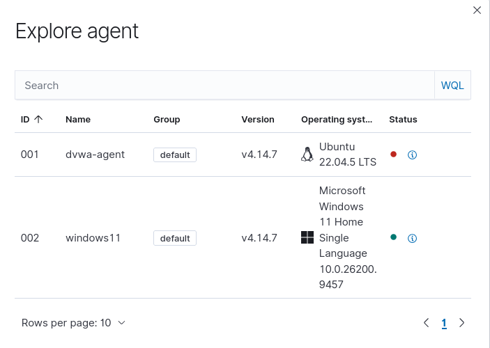

### 2. Sysmon telemetry and detection

Sysmon events collected from the Windows agent.

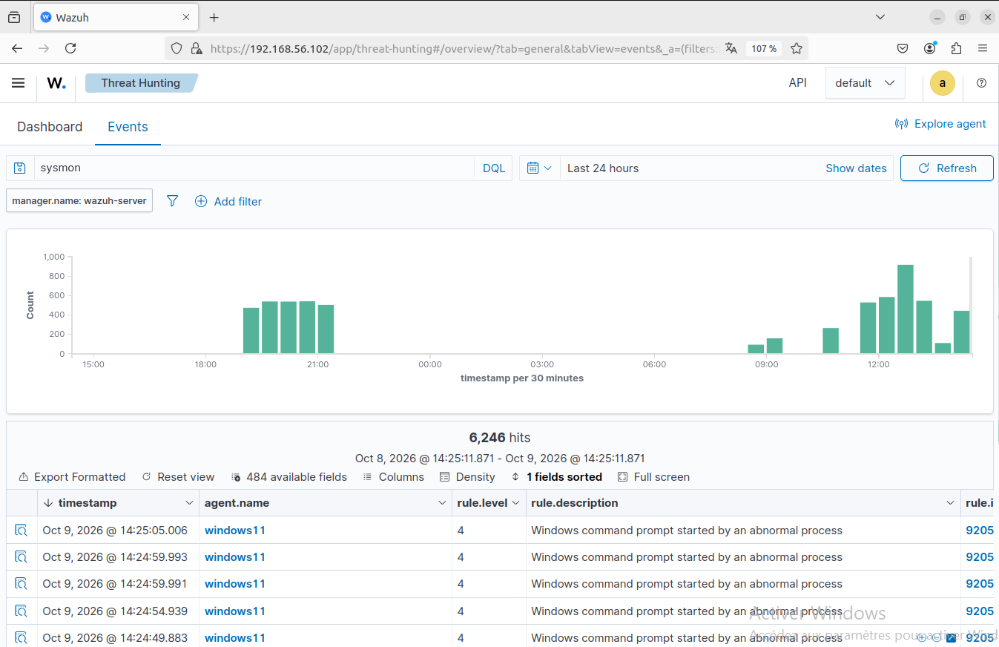

Process creation (event ID 1) detected by rule 92052, mapped to MITRE T1059.003.

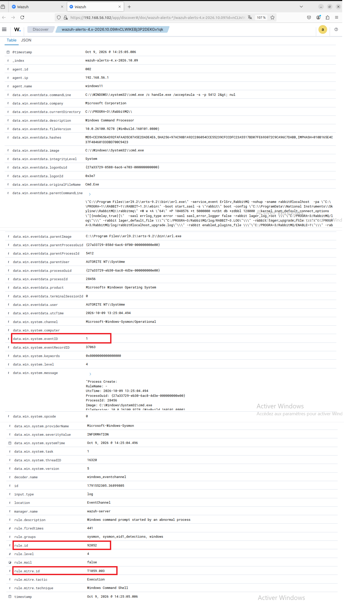

### 3. File Integrity Monitoring

File creation, modification and deletion detected on the monitored folder.

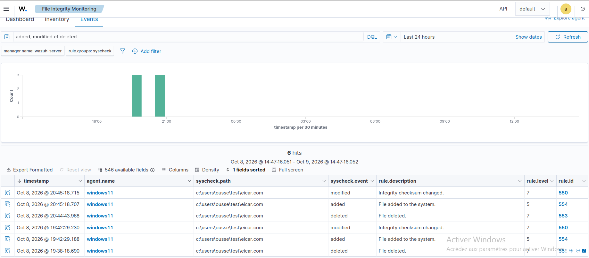

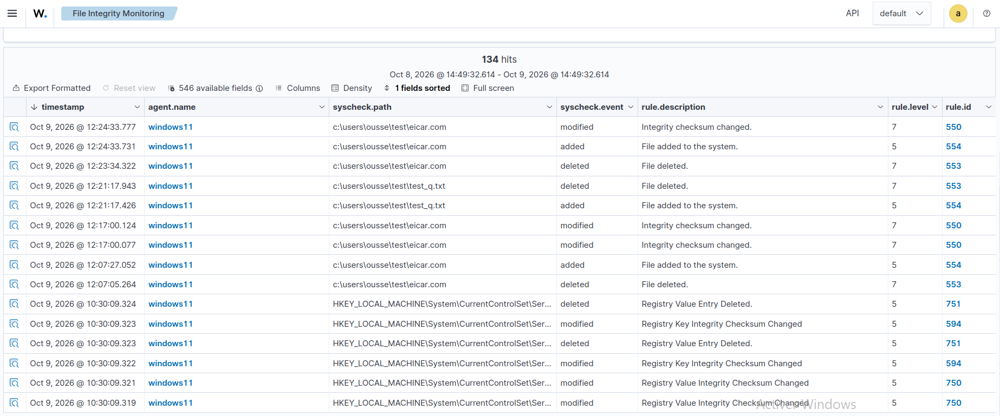

### 4. VirusTotal enrichment

VirusTotal alerts listed in the dashboard.

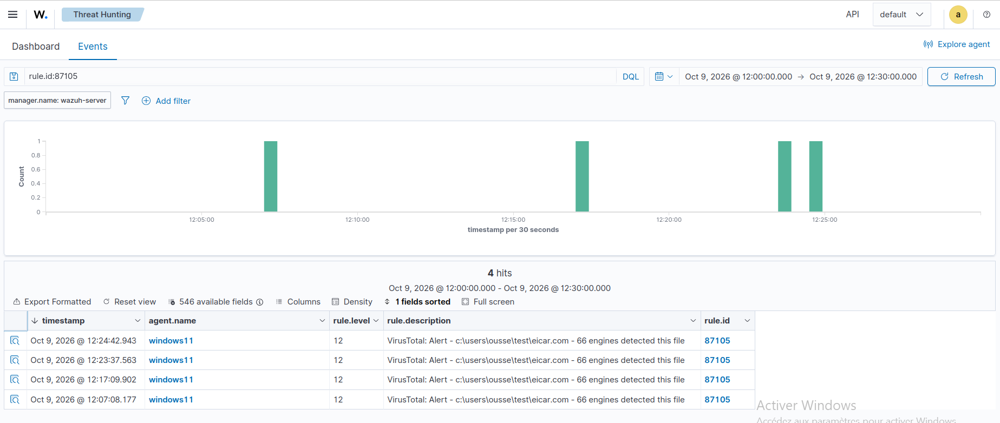

Rule 87105, level 12: 66 of 68 engines detect the EICAR test file.

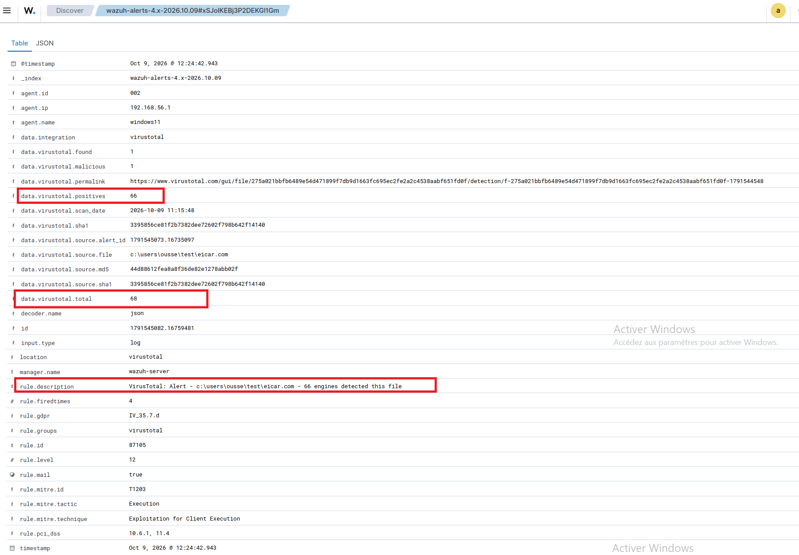

VirusTotal analysis page of the file.

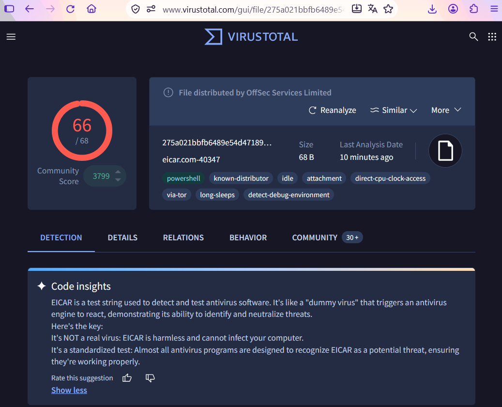

### 5. Discord notification

Structured alert delivered by the custom Python integration.

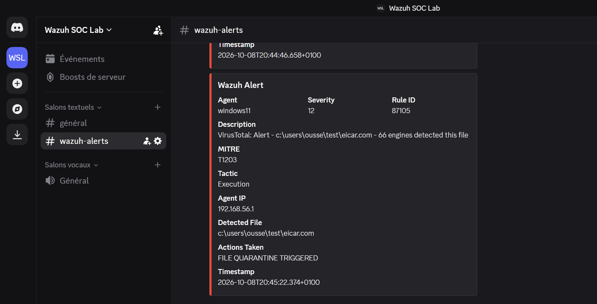

### 6. Automated response on Linux (firewall-drop)

SSH brute force simulated with Hydra from Kali against the Wazuh server.

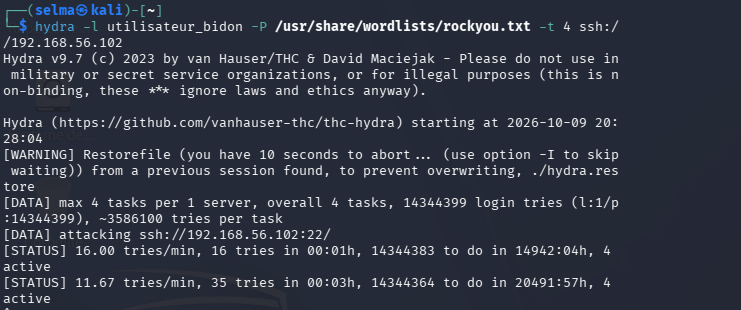

Source IP blocked by the firewall rule added by Active Response.

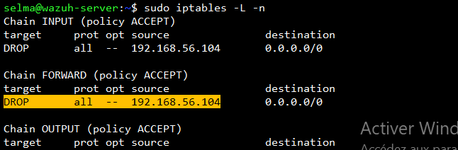

Discord notification reporting the blocked IP.

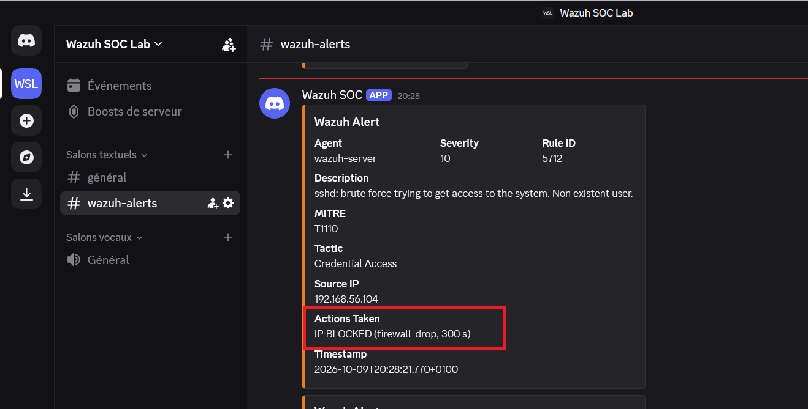

### 7. Automated response on Windows (file quarantine)

Detected file moved to the quarantine folder under a timestamped name.

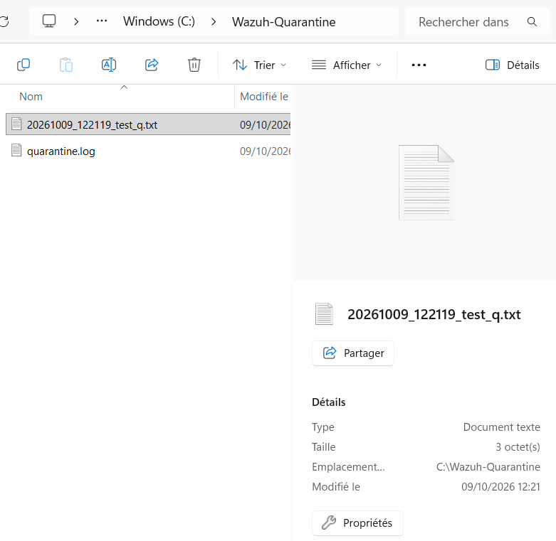

Execution log of the quarantine script.

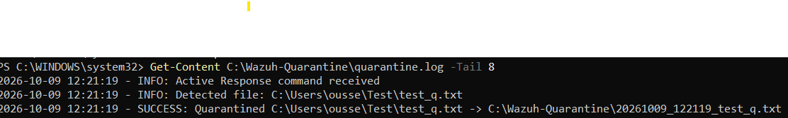

## Repository structure

- `docs/`: technical report and architecture diagram

- `configs/`: sanitized configuration snippets (no secrets)

- `scripts/`: Discord integration and quarantine response

- `screenshots/`: evidence of each test

## How to reproduce

1. Install a Wazuh all-in-one server and enroll a Windows and a Linux agent.

2. Install Sysmon on Windows and add the Sysmon channel to the agent configuration.

3. Add the snippets from `configs/` to the manager and agent configuration, replacing every

   `YOUR_*` placeholder with your own values (VirusTotal API key, Discord webhook).

4. Copy `scripts/custom-discord.py` to `/var/ossec/integrations/` on the manager and

   `quarantine-file.cmd` / `quarantine-file.ps1` to the Windows agent `active-response/bin` folder.

5. Restart the manager and the agent, then run the tests listed above.

## Lessons learned

- A stopped Filebeat service leaves alerts unindexed: the dashboard looked empty although alerts existed.

- FIM creates an empty file first, then the content: VirusTotal flags EICAR only on the second event.

- The free VirusTotal API is limited to 4 requests per minute.

- An agent must receive its updated response configuration before a new Active Response works.

- The "Actions Taken" field in Discord means a response was triggered, not that it succeeded.

## Limitations and next steps

- Custom detection rules and alert tuning

- Atomic Red Team scenarios to measure MITRE coverage

- SOAR / case management (Shuffle, TheHive)

## Disclaimer

Educational lab in an isolated environment. EICAR is a harmless standard antivirus test file.

All attack simulations targeted only my own machines.

## Author

Selma, Master's student in IS Audit and Security, FSEG Sfax, Tunisia.

